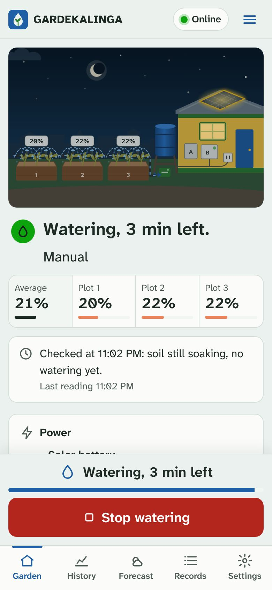
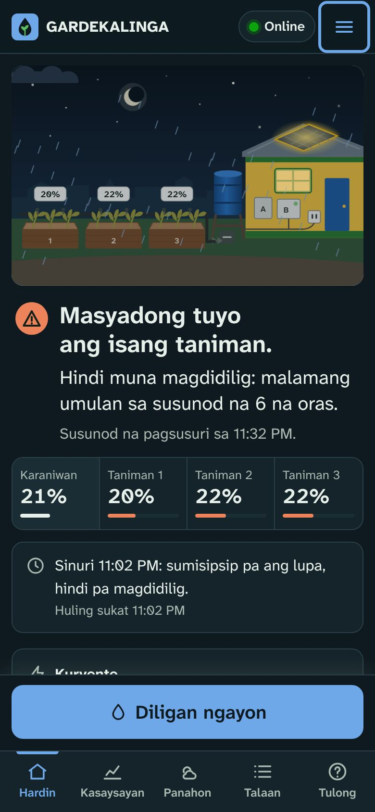
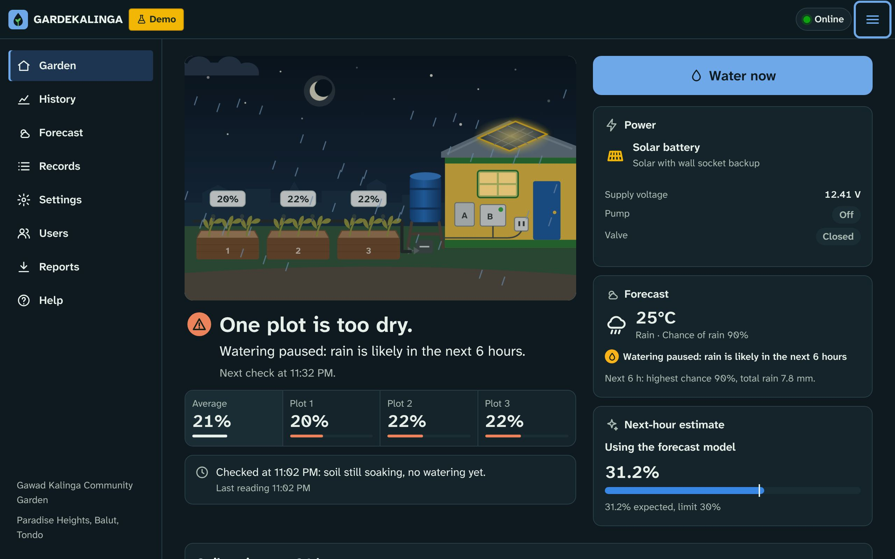

# GARDEKALINGA

Hybrid solar-powered, AI-assisted IoT soil monitoring and predictive irrigation for the
**Gawad Kalinga Community Garden**, Paradise Heights, Balut, Tondo, Manila.

BSIT, College of Computer Studies, Our Lady of Fatima University: Rhuzel Adonis, Camillus Borja,
Justine Melchor, Darell Sopeña. Adviser: Mark Anthony Ureta.

| Phone, light ("Umaga"), watering | Phone, Filipino, dark ("Gabi"), rain pause | Desktop, dark |
|---|---|---|
|  |  |  |

## What is in this repository

| Folder | What it is |
|---|---|
| `frontend/` | Web dashboard: React + TypeScript + Vite. Live SVG garden scene, "Langit" sky theme (Auto / Light / Dark), English and Filipino, charts with table views, PWA shell. |
| `backend/` | Flask API: ERD tables (SQLAlchemy + Alembic, MySQL 8.4), auth and roles, HMAC device API, decision engine with rain pause, OpenWeatherMap client, Random Forest (scikit-learn training, pure-Python inference), reports, test bench. |
| `api/index.py` | Vercel entry point for the API. |
| `worker/` | Scheduler for the Docker deployment (forecast, offline marking, daily water, training, backups). |
| `firmware/gardekalinga_node/` | ESP32 firmware for Box B (three probes, interlock, fail-safe, fault schedule, power watch, watchdog, setup page). |
| `firmware/legacy_single_probe/` | The group's original 1-probe sketch, updated to report to this dashboard and obey Water now / Stop. |
| `firmware/original/` | `sketch_nov20a.ino` exactly as provided. |
| `tools/` | Device simulator (signs requests like the firmware), demo-model trainer. |
| `deploy/` | Docker Compose (Caddy HTTPS, API, worker, MySQL, backups). |
| `docs/` | Decisions, deployment, API (OpenAPI 3.1), test evidence, operations, user guides EN / FIL. |

## Quick start

**See it on Vercel in two minutes (demo mode, no database):** import the repository in Vercel and set
`GK_DEMO_MODE=true` and `SECRET_KEY`. Sign in with `manager`, `caretaker` or `leader` and the
password `gardekalinga-demo`. The demo garden has 17 days of history, a trained model and a virtual
controller. Water now really waters, and the **Demo** button breaks a sensor, cuts the internet,
switches the power or brings rain. Full steps: [docs/DEPLOY.md](docs/DEPLOY.md).

**On your computer:**

```bash
python3 -m venv .venv && . .venv/bin/activate && pip install -r requirements-dev.txt
```

```bash
make dev-api
```

```bash
cd frontend && npm install && npm run dev
```

**Production:** Vercel with managed MySQL, or Docker on a mini PC in the garden house
(`make up`, `make migrate`, `make create-manager`, `make register-device`). See [docs/DEPLOY.md](docs/DEPLOY.md).

## How watering is decided (paper, four tiers)

1. **Maximum watering time**: enforced by the node for every trigger; the server never asks for more.
2. **Manual override**: Water now / Stop from the dashboard (caretakers and managers), logged with user and time.
3. **Online predictive control**: every 30-minute reading. Cold start (first 14 days): water when the average is below the limit.
   After that: when the Random Forest's next-hour estimate is below the limit, but only while the model beats "same as now".
   Any plot below its minimum also waters. Watering pauses when the forecast gives ≥ 70 % chance and ≥ 2 mm of rain within 6 h.
   A soak interval follows each cycle.
4. **Offline fail-safe**: after a failed POST and two retries, the node decides from its own readings. When every probe is
   faulty it waters at 06:00 (60 %) and 16:00 (40 %).

## Verified in this build

| Check | Result |
|---|---|
| Backend tests (`pytest`) | 51 passed on SQLite; the same suite passes on **MySQL 8.4** |
| Coverage | decision engine 97 %, rain pause 100 %, device service 90 %, ML pipeline 82–88 % (inference path 36 %, exercised end to end by the demo) |
| Firmware logic tests (native, g++) | 17 passed: interlock 500 ms / 100 ms, max-time clamp, hysteresis, fail-safe, fault schedule, rollover |
| Vercel | `vercel build` succeeded; the built function (Python 3.12, **no scikit-learn**) served login, status in ~60 ms and live model predictions |
| Device simulator, end to end | 49 readings stored for 24 h, target ≥ 46 of 48 (TC4), offline buffer synced idempotently (TC10), command latency 2.0 s (≤ 6 s), manual stop logged with user (TC7), interlock 498 ms (TC6) |
| Accessibility (axe, WCAG 2.1 AA) | 0 violations on all 9 screens |
| Bundle budgets | initial JS ≈ 138 KB gzip (budget 170), fonts 53 KB (budget 60), poll response < 300 bytes |
| Not run here | ESP32 compile (toolchain download blocked in this environment; CI compiles it), Docker image build (same reason; compose file validated, gunicorn + worker run against MySQL), Playwright on WebKit/Firefox |

## Demo script (thesis defense)

1. Sign in as **caretaker** (Filipino). Read the garden status, then tap **Diligan ngayon** → 1 min → **Simulan**.
   Watch "Ipinapadala…" become watering, then tap **Itigil**.
2. **Demo → Rain coming.** The forecast shows the rain pause and the next check says watering is paused.
3. **Demo → Sensor problem on Plot 2.** The plot turns hatched grey and is left out of the average.
4. **Demo → Controller offline.** The garden shows "Controller offline". Water now is disabled with the reason. Turn it back on:
   buffered readings are synced and marked offline.
5. Sign in as **manager**: Settings (change the limit, see the new version and the audit trail), Forecast (model card), Reports (CSV, test bench).
6. Sign in as **leader**: read-only garden, records and reports.

## Hardware note: check the pins

The original sketch drives the **pump on GPIO26 and the valve on GPIO27**. The paper fixes **valve K1 = GPIO26, pump K2 = GPIO27**.
The full firmware follows the paper; the bridge sketch keeps the original wiring. Check Box B before flashing. See [firmware/README.md](firmware/README.md).

## Documents

[PLAN.md](PLAN.md) · [CHANGELOG.md](CHANGELOG.md) · [docs/DECISIONS.md](docs/DECISIONS.md) · [docs/DEPLOY.md](docs/DEPLOY.md) ·
[docs/API.md](docs/API.md) · [docs/TEST_EVIDENCE.md](docs/TEST_EVIDENCE.md) · [docs/OPERATIONS.md](docs/OPERATIONS.md) ·
[User guide (EN)](docs/USER_GUIDE_EN.md) · [Gabay (FIL)](docs/USER_GUIDE_FIL.md) · [BUILD_PROMPT.md](BUILD_PROMPT.md)
